# DIA-001 — Entity Relationship Model v1.0 (Logical Data Model)

**Project:** «Взлёт талантов» — цифровая экосистема для организации детских творческих конкурсов
**Document type:** Logical Data Model / Entity-Relationship Model (business & logical level)
**Status:** Draft for review (v1.0)
**Owner:** Data Architecture Group
**Source of truth:** [ARCH-001](../architecture/ARCH-001-vt-platform-architecture.md) · [DATA-001](../business/DATA-001-business-data-model.md) · [DATA-002](../business/DATA-002-business-rules-catalog.md) · [DATA-003](../business/DATA-003-domain-event-catalog.md) · [DATA-004](../business/DATA-004-state-machine-catalog.md)
**Last updated:** 2026-07-05

> This is a **logical data model**. It is **not** a PostgreSQL schema, **not** Django ORM, and **not** implementation. It expresses entities, identity, relationships, cardinality, ownership, and integrity **at the logical level**, deriving directly from the business objects of [DATA-001](../business/DATA-001-business-data-model.md), the rules of [DATA-002](../business/DATA-002-business-rules-catalog.md), the events of [DATA-003](../business/DATA-003-domain-event-catalog.md), and the state machines of [DATA-004](../business/DATA-004-state-machine-catalog.md). Physical realization (tables, keys, indexes, partitioning) is governed by [ARCH-001 §9](../architecture/ARCH-001-vt-platform-architecture.md#9-database-architecture) and is out of scope here. This model must not contradict its sources.

---

## Table of Contents

1. [Purpose & Scope](#1-purpose--scope)
2. [Notation & Conventions](#2-notation--conventions)
3. [High-Level Domain Map](#3-high-level-domain-map)
4. [Entity Specifications](#4-entity-specifications)
   - [Identity](#41-identity) · [Participants](#42-participants) · [Institutions](#43-institutions) · [Competitions](#44-competitions) · [Applications](#45-applications) · [Performances](#46-performances) · [Judging](#47-judging) · [Results](#48-results) · [Finance](#49-finance) · [Notifications](#410-notifications) · [Analytics](#411-analytics) · [Audit](#412-audit)
5. [Mermaid ER Diagrams (per domain)](#5-mermaid-er-diagrams-per-domain)
6. [Relationship Matrix](#6-relationship-matrix)
7. [Aggregate Diagrams](#7-aggregate-diagrams)
8. [Cross-Domain Relationships](#8-cross-domain-relationships)
9. [Referential Integrity Rules](#9-referential-integrity-rules)
10. [Deletion Strategy](#10-deletion-strategy)
11. [History Strategy](#11-history-strategy)
12. [Audit Strategy](#12-audit-strategy)
13. [Naming Conventions](#13-naming-conventions)
14. [Summary Statistics](#14-summary-statistics)

---

## 1. Purpose & Scope

### 1.1 Purpose

To provide the **logical bridge** between the business model and any physical schema: a precise, technology-neutral picture of the platform's entities and how they relate. It lets data, backend, and API teams reason about identity, cardinality, ownership, and integrity **before** committing to storage decisions, and it keeps those decisions traceable to business objects, rules, events, and states.

### 1.2 Scope

- **In scope:** logical entities and their identity; parent/child structure; relationships and cardinality; aggregate ownership; cross-domain references; referential integrity, deletion, history, and audit strategies; naming conventions; and Mermaid ER diagrams.
- **Out of scope:** column types, physical keys/indexes, PostgreSQL schemas, ORM classes, migrations, and query design (see [ARCH-001 §9](../architecture/ARCH-001-vt-platform-architecture.md#9-database-architecture)).

### 1.3 Modeling Convention (coverage)

Following the established series convention, **full entity specifications** are given for the **core entities, aggregate roots, and their principal children** — the entities that carry meaningful relationships (~72 entities). Supporting/derived records enumerated in [DATA-001 §5](../business/DATA-001-business-data-model.md#5-business-object-catalog) that hold no cross-entity relationship (pure history/snapshot/lookup rows) are represented through their owning aggregate and are not given standalone ER cards. Every modeled relationship appears in the [Relationship Matrix](#6-relationship-matrix).

---

## 2. Notation & Conventions

### 2.1 Cardinality Notation

Logical cardinality is written `A n----m B` and, in Mermaid, with crow's-foot notation:

| Meaning | Text form | Mermaid |
|---------|-----------|---------|
| One to zero-or-many | `1 ---- *` | `\|\|--o{` |
| One to one-or-many | `1 ---- 1..*` | `\|\|--\|{` |
| One to exactly one | `1 ---- 1` | `\|\|--\|\|` |
| One to zero-or-one | `1 ---- 0..1` | `\|\|--o\|` |
| Many to many | `* ---- *` | `}o--o{` |

Many-to-many relationships are resolved through an **association entity** (e.g., `PARTICIPANT * — * GUARDIAN` resolves via `GUARDIAN_RELATIONSHIP`).

### 2.2 Identity

Per [DATA-001 §9](../business/DATA-001-business-data-model.md#9-entity-identity-strategy): **aggregate roots and externally referenced entities** carry a **global business identifier** (UUID-class, non-guessable — [ARCH-001 §9.4](../architecture/ARCH-001-vt-platform-architecture.md#9-database-architecture)); **entities internal to an aggregate** carry a **local identifier** unique within their aggregate root. Cross-aggregate references are held **by identity**, never by structural nesting ([ARCH-001 §9.2](../architecture/ARCH-001-vt-platform-architecture.md#9-database-architecture)).

### 2.3 Ownership

Each entity is owned by exactly one **domain / bounded context**. Cross-domain relationships are **logical references by identity** and are resolved through the owning domain's interface — never by foreign keys across context boundaries at the physical level ([ARCH-001 §9.2](../architecture/ARCH-001-vt-platform-architecture.md#9-database-architecture)). In the diagrams these appear as dashed/annotated references (documented in §8).

### 2.4 Entity Card Fields

Each entity card provides: **Description · Identifier · Aggregate Root · Parent Entity · Child Entities · Relationships · Cardinality · Ownership · Lifecycle Reference · State Machine Reference · Business Rules References.**

---

## 3. High-Level Domain Map

The twelve domains and their principal aggregate roots (one representative entity per domain shown; see §5 for full per-domain diagrams).

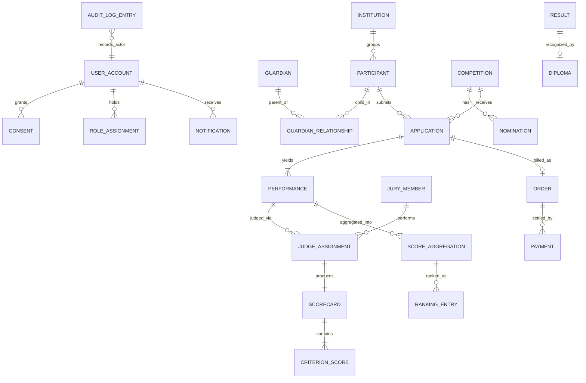

---

## 4. Entity Specifications

> Cardinality per relationship is summarized here and consolidated in the [Relationship Matrix](#6-relationship-matrix). "AR" = aggregate root.

### 4.1 Identity

#### USER_ACCOUNT
- **Description:** An authenticated adult actor (guardian, teacher, jury, organizer, administrator).
- **Identifier:** Global.
- **Aggregate Root:** USER_ACCOUNT (self).
- **Parent Entity:** —
- **Child Entities:** CREDENTIAL, AUTHENTICATION_SESSION, MULTI_FACTOR_ENROLLMENT, ROLE_ASSIGNMENT, TERMS_ACCEPTANCE.
- **Relationships:** grants CONSENT (1—*); linked to GUARDIAN/TEACHER/JURY_MEMBER/ORGANIZER (1—0..1 each); owns BILLING_ACCOUNT (1—0..1); receives NOTIFICATION (1—*); subject of AUDIT_LOG_ENTRY (1—*).
- **Cardinality:** 1—* to most children.
- **Ownership:** Identity.
- **Lifecycle Reference:** DATA-001 §4.1.
- **State Machine Reference:** — (managed states: Registered→…→Erased).
- **Business Rules References:** IDN-001, IDN-002, IDN-003, IDN-004, IDN-007, IDN-008.

#### ROLE
- **Description:** A named bundle of permissions.
- **Identifier:** Global.
- **Aggregate Root:** ROLE (self).
- **Parent Entity:** —
- **Child Entities:** — (references PERMISSION).
- **Relationships:** groups PERMISSION (*—*, via ROLE_PERMISSION); granted via ROLE_ASSIGNMENT (1—*).
- **Cardinality:** ROLE *—* PERMISSION.
- **Ownership:** Identity.
- **Lifecycle Reference:** DATA-001 §4.1.
- **State Machine Reference:** —
- **Business Rules References:** IDN-008, IDN-002.

#### PERMISSION
- **Description:** An atomic capability.
- **Identifier:** Global.
- **Aggregate Root:** ROLE (referenced).
- **Parent Entity:** —
- **Child Entities:** —
- **Relationships:** grouped into ROLE (*—*).
- **Cardinality:** *—*.
- **Ownership:** Identity.
- **Lifecycle Reference:** DATA-001 §5.1.
- **State Machine Reference:** —
- **Business Rules References:** IDN-008.

#### ROLE_ASSIGNMENT
- **Description:** Binds a role to a user within a scope.
- **Identifier:** Global.
- **Aggregate Root:** USER_ACCOUNT.
- **Parent Entity:** USER_ACCOUNT.
- **Child Entities:** —
- **Relationships:** links USER_ACCOUNT (*—1) and ROLE (*—1); scope references INSTITUTION or COMPETITION (0..1).
- **Cardinality:** * per user.
- **Ownership:** Identity.
- **Lifecycle Reference:** DATA-001 §5.1.
- **State Machine Reference:** —
- **Business Rules References:** IDN-008, INS-003, CMP-008.

#### CONSENT
- **Description:** A guardian's versioned, purpose-limited authorization for a minor.
- **Identifier:** Global.
- **Aggregate Root:** CONSENT (self).
- **Parent Entity:** —
- **Child Entities:** CONSENT_AUDIT_RECORD (audit-owned copy).
- **Relationships:** granted by USER_ACCOUNT/GUARDIAN (*—1); about PARTICIPANT (*—1); of CONSENT_TYPE (*—1); snapshotted into CONSENT_SNAPSHOT (1—*).
- **Cardinality:** GUARDIAN 1—* CONSENT; PARTICIPANT 1—* CONSENT.
- **Ownership:** Identity.
- **Lifecycle Reference:** DATA-001 §4.1.
- **State Machine Reference:** DATA-004 (referenced by Participant activation).
- **Business Rules References:** IDN-005, IDN-006, PRT-001, APP-001.

#### CONSENT_TYPE
- **Description:** A category/purpose of consent.
- **Identifier:** Global.
- **Aggregate Root:** CONSENT_TYPE (self, reference data).
- **Parent Entity:** —
- **Child Entities:** —
- **Relationships:** classifies CONSENT (1—*).
- **Cardinality:** 1—*.
- **Ownership:** Identity.
- **Lifecycle Reference:** DATA-001 §5.1.
- **State Machine Reference:** —
- **Business Rules References:** IDN-005.

### 4.2 Participants

#### PARTICIPANT
- **Description:** A child participating in competitions.
- **Identifier:** Global (non-enumerable — minor privacy).
- **Aggregate Root:** PARTICIPANT (self).
- **Parent Entity:** —
- **Child Entities:** PARTICIPANT_PROFILE, TALENT_INTEREST, PARTICIPANT_PORTFOLIO, PARTICIPANT_GROUP_MEMBERSHIP, PARTICIPANT_INSTITUTION_MEMBERSHIP.
- **Relationships:** child in GUARDIAN_RELATIONSHIP (1—*); linked via TEACHER_RELATIONSHIP (*—*); member of INSTITUTION (via membership, *—0..1); submits APPLICATION (1—*); subject of PERFORMANCE (1—*, via application); has RESULT (1—*); about CONSENT (1—*).
- **Cardinality:** **PARTICIPANT 1 ---- * APPLICATION**.
- **Ownership:** Participants.
- **Lifecycle Reference:** DATA-001 §4.2.
- **State Machine Reference:** DATA-004 §4.3 (PRT).
- **Business Rules References:** PRT-001, PRT-002, PRT-006, PRT-007, JDG-006.

#### GUARDIAN
- **Description:** Parent/legal guardian responsible for participants.
- **Identifier:** Global.
- **Aggregate Root:** GUARDIAN (self); linked to USER_ACCOUNT.
- **Parent Entity:** USER_ACCOUNT (identity link).
- **Child Entities:** GUARDIAN_PROFILE.
- **Relationships:** parent in GUARDIAN_RELATIONSHIP (1—*); grants CONSENT (1—*); may own BILLING_ACCOUNT (via account).
- **Cardinality:** GUARDIAN *—* PARTICIPANT (via relationship).
- **Ownership:** Participants.
- **Lifecycle Reference:** DATA-001 §4.2.
- **State Machine Reference:** —
- **Business Rules References:** PRT-001, PRT-003, PRT-008.

#### TEACHER
- **Description:** Educator managing participants within an institution.
- **Identifier:** Global.
- **Aggregate Root:** TEACHER (self); linked to USER_ACCOUNT.
- **Parent Entity:** USER_ACCOUNT (identity link).
- **Child Entities:** TEACHER_PROFILE.
- **Relationships:** assigned via TEACHER_ASSIGNMENT to INSTITUTION/CLASS_GROUP (*—*); links to PARTICIPANT via TEACHER_RELATIONSHIP (*—*).
- **Cardinality:** TEACHER *—* CLASS_GROUP.
- **Ownership:** Participants (institution-scoped).
- **Lifecycle Reference:** DATA-001 §4.2.
- **State Machine Reference:** —
- **Business Rules References:** PRT-004, PRT-005, JDG-001.

#### GUARDIAN_RELATIONSHIP
- **Description:** Authoritative guardian↔participant link.
- **Identifier:** Global.
- **Aggregate Root:** PARTICIPANT (association).
- **Parent Entity:** PARTICIPANT / GUARDIAN.
- **Child Entities:** —
- **Relationships:** connects GUARDIAN (*—1) and PARTICIPANT (*—1).
- **Cardinality:** resolves GUARDIAN *—* PARTICIPANT.
- **Ownership:** Participants.
- **Lifecycle Reference:** DATA-001 §4.2.
- **State Machine Reference:** —
- **Business Rules References:** PRT-001, PRT-003, PRT-008.

#### TEACHER_RELATIONSHIP
- **Description:** Teacher↔participant link.
- **Identifier:** Global.
- **Aggregate Root:** PARTICIPANT (association).
- **Parent Entity:** PARTICIPANT / TEACHER.
- **Child Entities:** —
- **Relationships:** connects TEACHER (*—1) and PARTICIPANT (*—1).
- **Cardinality:** resolves TEACHER *—* PARTICIPANT.
- **Ownership:** Participants.
- **Lifecycle Reference:** DATA-001 §5.2.
- **State Machine Reference:** —
- **Business Rules References:** PRT-004, JDG-001.

#### PARTICIPANT_INSTITUTION_MEMBERSHIP
- **Description:** Links a participant to an institution.
- **Identifier:** Global.
- **Aggregate Root:** PARTICIPANT (association).
- **Parent Entity:** PARTICIPANT.
- **Child Entities:** —
- **Relationships:** connects PARTICIPANT (*—1) and INSTITUTION (*—1).
- **Cardinality:** resolves PARTICIPANT *—* INSTITUTION.
- **Ownership:** Participants / Institutions.
- **Lifecycle Reference:** DATA-001 §5.2.
- **State Machine Reference:** —
- **Business Rules References:** INS-002, INS-004.

#### PARTICIPANT_GROUP_MEMBERSHIP
- **Description:** Links a participant to a class group.
- **Identifier:** Global.
- **Aggregate Root:** CLASS_GROUP (association).
- **Parent Entity:** CLASS_GROUP.
- **Child Entities:** —
- **Relationships:** connects PARTICIPANT (*—1) and CLASS_GROUP (*—1).
- **Cardinality:** resolves PARTICIPANT *—* CLASS_GROUP.
- **Ownership:** Institutions.
- **Lifecycle Reference:** DATA-001 §5.2.
- **State Machine Reference:** —
- **Business Rules References:** INS-004.

#### PARTICIPANT_PORTFOLIO
- **Description:** Collection of a child's works/results.
- **Identifier:** Global.
- **Aggregate Root:** PARTICIPANT.
- **Parent Entity:** PARTICIPANT.
- **Child Entities:** — (references PERFORMANCE, RESULT).
- **Relationships:** belongs to PARTICIPANT (*—1); references PERFORMANCE and RESULT (logical).
- **Cardinality:** PARTICIPANT 1—0..1 PORTFOLIO.
- **Ownership:** Participants.
- **Lifecycle Reference:** DATA-001 §5.2.
- **State Machine Reference:** —
- **Business Rules References:** PRT-006.

### 4.3 Institutions

#### INSTITUTION
- **Description:** Educational/creative organization; tenancy anchor.
- **Identifier:** Global.
- **Aggregate Root:** INSTITUTION (self).
- **Parent Entity:** —
- **Child Entities:** INSTITUTION_PROFILE, INSTITUTION_ADMINISTRATOR, CLASS_GROUP, TEACHER_ASSIGNMENT, INSTITUTION_VERIFICATION, INSTITUTION_CONTACT.
- **Relationships:** located in REGION/LOCALITY (*—1); groups PARTICIPANT (1—*, via membership); has SUBSCRIPTION (1—0..1).
- **Cardinality:** INSTITUTION 1—* CLASS_GROUP.
- **Ownership:** Institutions.
- **Lifecycle Reference:** DATA-001 §4.3.
- **State Machine Reference:** — (Registered→…→Archived).
- **Business Rules References:** INS-001, INS-002, INS-005.

#### INSTITUTION_ADMINISTRATOR
- **Description:** Person authorized to govern an institution.
- **Identifier:** Global.
- **Aggregate Root:** INSTITUTION.
- **Parent Entity:** INSTITUTION.
- **Child Entities:** —
- **Relationships:** links USER_ACCOUNT (*—1) and INSTITUTION (*—1); grants TEACHER_ASSIGNMENT (1—*).
- **Cardinality:** INSTITUTION 1—* ADMINISTRATOR.
- **Ownership:** Institutions.
- **Lifecycle Reference:** DATA-001 §4.3.
- **State Machine Reference:** —
- **Business Rules References:** INS-002, INS-003.

#### CLASS_GROUP
- **Description:** A teaching unit of participants within an institution.
- **Identifier:** Global.
- **Aggregate Root:** CLASS_GROUP (self); part of INSTITUTION.
- **Parent Entity:** INSTITUTION.
- **Child Entities:** PARTICIPANT_GROUP_MEMBERSHIP.
- **Relationships:** belongs to INSTITUTION (*—1); managed by TEACHER (via assignment); contains PARTICIPANT (1—*, via membership).
- **Cardinality:** **INSTITUTION 1 ---- * CLASS_GROUP**.
- **Ownership:** Institutions.
- **Lifecycle Reference:** DATA-001 §4.3.
- **State Machine Reference:** —
- **Business Rules References:** INS-004.

#### TEACHER_ASSIGNMENT
- **Description:** Assigns a teacher to an institution/class.
- **Identifier:** Global.
- **Aggregate Root:** INSTITUTION (association).
- **Parent Entity:** INSTITUTION.
- **Child Entities:** —
- **Relationships:** connects TEACHER (*—1), INSTITUTION (*—1), CLASS_GROUP (*—0..1).
- **Cardinality:** resolves TEACHER *—* INSTITUTION.
- **Ownership:** Institutions.
- **Lifecycle Reference:** DATA-001 §5.3.
- **State Machine Reference:** —
- **Business Rules References:** INS-003, PRT-004.

#### REGION
- **Description:** Administrative region reference.
- **Identifier:** Global (reference data).
- **Aggregate Root:** REGION (self).
- **Parent Entity:** —
- **Child Entities:** LOCALITY.
- **Relationships:** contains LOCALITY (1—*); located by INSTITUTION (1—*).
- **Cardinality:** REGION 1—* LOCALITY.
- **Ownership:** Institutions (shared reference).
- **Lifecycle Reference:** DATA-001 §5.3.
- **State Machine Reference:** —
- **Business Rules References:** —

#### LOCALITY
- **Description:** City/town reference.
- **Identifier:** Global (reference data).
- **Aggregate Root:** REGION.
- **Parent Entity:** REGION.
- **Child Entities:** —
- **Relationships:** belongs to REGION (*—1); locates INSTITUTION (1—*).
- **Cardinality:** *—1 to REGION.
- **Ownership:** Institutions (shared reference).
- **Lifecycle Reference:** DATA-001 §5.3.
- **State Machine Reference:** —
- **Business Rules References:** —

### 4.4 Competitions

#### COMPETITION
- **Description:** Time-bounded creative competition event.
- **Identifier:** Global.
- **Aggregate Root:** COMPETITION (self).
- **Parent Entity:** COMPETITION_SERIES (0..1).
- **Child Entities:** NOMINATION, AGE_GROUP, ROUND, CRITERIA_SET, COMPETITION_SCHEDULE, COMPETITION_RULE, ELIGIBILITY_RULE, PRIZE, FEE_SCHEDULE, ORGANIZER_ASSIGNMENT, COMPETITION_ANNOUNCEMENT, COMPETITION_STATUS_HISTORY.
- **Relationships:** belongs to COMPETITION_SERIES (*—0..1); receives APPLICATION (1—*); produces RESULT (1—*); assigned ORGANIZER (via assignment).
- **Cardinality:** **COMPETITION 1 ---- * NOMINATION**; **COMPETITION 1 ---- * PERFORMANCE** (indirect via application).
- **Ownership:** Competitions.
- **Lifecycle Reference:** DATA-001 §4.4.
- **State Machine Reference:** DATA-004 §4.1 (CMP).
- **Business Rules References:** CMP-001, CMP-002, CMP-003, CMP-005, CMP-006, CMP-008.

#### COMPETITION_SERIES
- **Description:** Grouping of recurring competitions.
- **Identifier:** Global.
- **Aggregate Root:** COMPETITION_SERIES (self).
- **Parent Entity:** —
- **Child Entities:** — (references COMPETITION).
- **Relationships:** groups COMPETITION (1—*).
- **Cardinality:** 1—*.
- **Ownership:** Competitions.
- **Lifecycle Reference:** DATA-001 §5.4.
- **State Machine Reference:** —
- **Business Rules References:** —

#### NOMINATION
- **Description:** A category of creative work within a competition (e.g., «Рисунок»).
- **Identifier:** Global.
- **Aggregate Root:** COMPETITION.
- **Parent Entity:** COMPETITION.
- **Child Entities:** —
- **Relationships:** belongs to COMPETITION (*—1); associated with AGE_GROUP (*—*); scored by CRITERIA_SET (*—1); targeted by APPLICATION (1—*).
- **Cardinality:** COMPETITION 1—* NOMINATION; NOMINATION 1—* APPLICATION.
- **Ownership:** Competitions.
- **Lifecycle Reference:** DATA-001 §4.4.
- **State Machine Reference:** —
- **Business Rules References:** CMP-002, CMP-005.

#### AGE_GROUP
- **Description:** An age band for fair comparison.
- **Identifier:** Global.
- **Aggregate Root:** COMPETITION.
- **Parent Entity:** COMPETITION.
- **Child Entities:** —
- **Relationships:** applies to NOMINATION (*—*); referenced by APPLICATION (1—*).
- **Cardinality:** COMPETITION 1—* AGE_GROUP.
- **Ownership:** Competitions.
- **Lifecycle Reference:** DATA-001 §5.4.
- **State Machine Reference:** —
- **Business Rules References:** PRT-002, APP-002, CMP-002.

#### ROUND
- **Description:** A judging stage within a competition.
- **Identifier:** Global.
- **Aggregate Root:** COMPETITION.
- **Parent Entity:** COMPETITION.
- **Child Entities:** SCORING_WINDOW (logical).
- **Relationships:** belongs to COMPETITION (*—1); governs JUDGE_ASSIGNMENT (1—*); references CRITERIA_SET (*—1).
- **Cardinality:** COMPETITION 1—* ROUND.
- **Ownership:** Competitions.
- **Lifecycle Reference:** DATA-001 §4.4.
- **State Machine Reference:** — (Planned→Open→Scoring→Closed).
- **Business Rules References:** CMP-005, JDG-003.

#### CRITERIA_SET
- **Description:** The weighted rubric for scoring a nomination/round.
- **Identifier:** Global.
- **Aggregate Root:** COMPETITION.
- **Parent Entity:** COMPETITION.
- **Child Entities:** JUDGING_CRITERION.
- **Relationships:** referenced by NOMINATION/ROUND (1—*); drives SCORECARD structure (1—*).
- **Cardinality:** CRITERIA_SET 1—* JUDGING_CRITERION.
- **Ownership:** Competitions.
- **Lifecycle Reference:** DATA-001 §4.4.
- **State Machine Reference:** — (Draft→Published→Frozen→Archived).
- **Business Rules References:** CMP-004, CMP-005, JDG-004.

#### JUDGING_CRITERION
- **Description:** A weighted evaluation dimension.
- **Identifier:** Local (within CRITERIA_SET).
- **Aggregate Root:** COMPETITION (via CRITERIA_SET).
- **Parent Entity:** CRITERIA_SET.
- **Child Entities:** —
- **Relationships:** grouped into CRITERIA_SET (*—1); scored by CRITERION_SCORE (1—*).
- **Cardinality:** CRITERIA_SET 1—* CRITERION.
- **Ownership:** Competitions.
- **Lifecycle Reference:** DATA-001 §4.4.
- **State Machine Reference:** —
- **Business Rules References:** CMP-004, JDG-005.

#### PRIZE
- **Description:** A reward offered for achievement.
- **Identifier:** Global.
- **Aggregate Root:** COMPETITION.
- **Parent Entity:** COMPETITION.
- **Child Entities:** PRIZE_TIER (reference).
- **Relationships:** belongs to COMPETITION (*—1); organized by PRIZE_TIER (*—1); realized via PRIZE_ALLOCATION (1—*).
- **Cardinality:** COMPETITION 1—* PRIZE.
- **Ownership:** Competitions.
- **Lifecycle Reference:** DATA-001 §4.4.
- **State Machine Reference:** —
- **Business Rules References:** CMP-007, RES-008.

#### ORGANIZER_ASSIGNMENT
- **Description:** Assigns an organizer to a competition.
- **Identifier:** Global.
- **Aggregate Root:** COMPETITION (association).
- **Parent Entity:** COMPETITION.
- **Child Entities:** —
- **Relationships:** connects USER_ACCOUNT (*—1) and COMPETITION (*—1).
- **Cardinality:** COMPETITION 1—* ORGANIZER_ASSIGNMENT.
- **Ownership:** Competitions.
- **Lifecycle Reference:** DATA-001 §5.4.
- **State Machine Reference:** —
- **Business Rules References:** CMP-008.

#### FEE_SCHEDULE
- **Description:** Participation fee definition.
- **Identifier:** Global.
- **Aggregate Root:** COMPETITION.
- **Parent Entity:** COMPETITION.
- **Child Entities:** —
- **Relationships:** priced into APPLICATION_FEE (1—*); may be reduced by DISCOUNT_POLICY.
- **Cardinality:** COMPETITION 1—0..1 FEE_SCHEDULE.
- **Ownership:** Competitions.
- **Lifecycle Reference:** DATA-001 §5.4.
- **State Machine Reference:** —
- **Business Rules References:** APP-003, FIN-003.

### 4.5 Applications

#### APPLICATION
- **Description:** A participant's request to enter a competition nomination.
- **Identifier:** Global.
- **Aggregate Root:** APPLICATION (self).
- **Parent Entity:** —
- **Child Entities:** APPLICATION_ANSWER, APPLICATION_ATTACHMENT, CONSENT_SNAPSHOT, ELIGIBILITY_CHECK, APPLICATION_FEE, APPLICATION_STATUS_HISTORY, WAITLIST_ENTRY, APPLICATION_WITHDRAWAL.
- **Relationships:** for PARTICIPANT (*—1); into COMPETITION/NOMINATION (*—1); yields PERFORMANCE (1—1..*); billed as ORDER (1—0..1).
- **Cardinality:** **PARTICIPANT 1 ---- * APPLICATION**; **APPLICATION 1 ---- 1..* PERFORMANCE**.
- **Ownership:** Applications.
- **Lifecycle Reference:** DATA-001 §4.5.
- **State Machine Reference:** DATA-004 §4.2 (APP).
- **Business Rules References:** APP-001, APP-002, APP-003, APP-005, APP-006.

#### APPLICATION_FORM
- **Description:** Structured entry questionnaire for a competition.
- **Identifier:** Global.
- **Aggregate Root:** APPLICATION_FORM (self); referenced by COMPETITION.
- **Parent Entity:** COMPETITION (logical).
- **Child Entities:** APPLICATION_FORM_FIELD.
- **Relationships:** has APPLICATION_FORM_FIELD (1—*); answered by APPLICATION_ANSWER (via fields).
- **Cardinality:** FORM 1—* FIELD.
- **Ownership:** Applications.
- **Lifecycle Reference:** DATA-001 §5.5.
- **State Machine Reference:** —
- **Business Rules References:** APP-002.

#### APPLICATION_ANSWER
- **Description:** A response to a form field.
- **Identifier:** Local (within APPLICATION).
- **Aggregate Root:** APPLICATION.
- **Parent Entity:** APPLICATION.
- **Child Entities:** —
- **Relationships:** answers APPLICATION_FORM_FIELD (*—1); belongs to APPLICATION (*—1).
- **Cardinality:** APPLICATION 1—* ANSWER.
- **Ownership:** Applications.
- **Lifecycle Reference:** DATA-001 §5.5.
- **State Machine Reference:** —
- **Business Rules References:** APP-002.

#### CONSENT_SNAPSHOT
- **Description:** Immutable copy of the consent in force at application time.
- **Identifier:** Global.
- **Aggregate Root:** APPLICATION.
- **Parent Entity:** APPLICATION.
- **Child Entities:** —
- **Relationships:** belongs to APPLICATION (1—1); derived from CONSENT (*—1).
- **Cardinality:** APPLICATION 1—1 CONSENT_SNAPSHOT.
- **Ownership:** Applications.
- **Lifecycle Reference:** DATA-001 §4.5.
- **State Machine Reference:** —
- **Business Rules References:** APP-001, APP-006.

#### ELIGIBILITY_CHECK
- **Description:** The eligibility decision for an application.
- **Identifier:** Global.
- **Aggregate Root:** APPLICATION.
- **Parent Entity:** APPLICATION.
- **Child Entities:** —
- **Relationships:** belongs to APPLICATION (1—1); evaluates ELIGIBILITY_RULE (*—*).
- **Cardinality:** APPLICATION 1—1 ELIGIBILITY_CHECK.
- **Ownership:** Applications.
- **Lifecycle Reference:** DATA-001 §4.5.
- **State Machine Reference:** —
- **Business Rules References:** APP-002, APP-004.

#### APPLICATION_FEE
- **Description:** The fee incurred by an entry.
- **Identifier:** Global.
- **Aggregate Root:** APPLICATION.
- **Parent Entity:** APPLICATION.
- **Child Entities:** —
- **Relationships:** belongs to APPLICATION (1—1); priced from FEE_SCHEDULE (*—1); settled via ORDER (0..1).
- **Cardinality:** APPLICATION 1—0..1 APPLICATION_FEE.
- **Ownership:** Applications / Finance boundary.
- **Lifecycle Reference:** DATA-001 §5.5.
- **State Machine Reference:** —
- **Business Rules References:** APP-003, FIN-003.

#### WAITLIST_ENTRY
- **Description:** Placeholder when capacity is full.
- **Identifier:** Global.
- **Aggregate Root:** APPLICATION.
- **Parent Entity:** APPLICATION.
- **Child Entities:** —
- **Relationships:** belongs to APPLICATION (1—0..1); ordered within COMPETITION.
- **Cardinality:** APPLICATION 1—0..1 WAITLIST_ENTRY.
- **Ownership:** Applications.
- **Lifecycle Reference:** DATA-001 §5.5.
- **State Machine Reference:** —
- **Business Rules References:** APP-007.

### 4.6 Performances

#### PERFORMANCE
- **Description:** The creative work a participant submits for evaluation.
- **Identifier:** Global (pseudonymized to jury).
- **Aggregate Root:** PERFORMANCE (self).
- **Parent Entity:** APPLICATION.
- **Child Entities:** MEDIA_ASSET, PERFORMANCE_VERSION, PERFORMANCE_STATUS_HISTORY, CONTENT_MODERATION_FLAG, PERFORMANCE_ATTACHMENT, PERFORMANCE_TAG, LIVE_PERFORMANCE_SLOT.
- **Relationships:** belongs to APPLICATION (*—1); judged via JUDGE_ASSIGNMENT (1—*); scored through SCORECARD (1—*); aggregated into SCORE_AGGREGATION (1—*); contributes to RESULT (1—0..1).
- **Cardinality:** **APPLICATION 1 ---- 1..* PERFORMANCE**; **PERFORMANCE 1 ---- * SCORECARD**.
- **Ownership:** Performances.
- **Lifecycle Reference:** DATA-001 §4.6.
- **State Machine Reference:** DATA-004 §4.4 (PRF).
- **Business Rules References:** PRF-001, PRF-002, PRF-005, PRF-006, JDG-006.

#### MEDIA_ASSET
- **Description:** A single uploaded media file belonging to a performance.
- **Identifier:** Global.
- **Aggregate Root:** PERFORMANCE.
- **Parent Entity:** PERFORMANCE.
- **Child Entities:** MEDIA_VARIANT, MEDIA_METADATA, ANTIVIRUS_SCAN_RESULT.
- **Relationships:** belongs to PERFORMANCE (*—1); has MEDIA_VARIANT (1—*); has ANTIVIRUS_SCAN_RESULT (1—1).
- **Cardinality:** PERFORMANCE 1—* MEDIA_ASSET.
- **Ownership:** Performances.
- **Lifecycle Reference:** DATA-001 §4.6.
- **State Machine Reference:** —
- **Business Rules References:** PRF-002, PRF-003, PRF-004.

#### MEDIA_VARIANT
- **Description:** A derived rendition (thumbnail/transcode).
- **Identifier:** Local (within MEDIA_ASSET).
- **Aggregate Root:** PERFORMANCE (via MEDIA_ASSET).
- **Parent Entity:** MEDIA_ASSET.
- **Child Entities:** —
- **Relationships:** derived from MEDIA_ASSET (*—1).
- **Cardinality:** MEDIA_ASSET 1—* VARIANT.
- **Ownership:** Performances.
- **Lifecycle Reference:** DATA-001 §5.6.
- **State Machine Reference:** —
- **Business Rules References:** PRF-004.

#### PERFORMANCE_VERSION
- **Description:** A revision of a work.
- **Identifier:** Local (within PERFORMANCE).
- **Aggregate Root:** PERFORMANCE.
- **Parent Entity:** PERFORMANCE.
- **Child Entities:** —
- **Relationships:** revision of PERFORMANCE (*—1).
- **Cardinality:** PERFORMANCE 1—* VERSION.
- **Ownership:** Performances.
- **Lifecycle Reference:** DATA-001 §5.6.
- **State Machine Reference:** —
- **Business Rules References:** PRF-005.

#### CONTENT_MODERATION_FLAG
- **Description:** A moderation concern on a performance/asset.
- **Identifier:** Global.
- **Aggregate Root:** PERFORMANCE.
- **Parent Entity:** PERFORMANCE.
- **Child Entities:** —
- **Relationships:** attached to PERFORMANCE or MEDIA_ASSET (*—1); feeds AUDIT.
- **Cardinality:** PERFORMANCE 1—* FLAG.
- **Ownership:** Performances.
- **Lifecycle Reference:** DATA-001 §4.6.
- **State Machine Reference:** —
- **Business Rules References:** PRF-006.

#### ANTIVIRUS_SCAN_RESULT
- **Description:** Safety scan outcome for media.
- **Identifier:** Local (within MEDIA_ASSET).
- **Aggregate Root:** PERFORMANCE (via MEDIA_ASSET).
- **Parent Entity:** MEDIA_ASSET.
- **Child Entities:** —
- **Relationships:** result for MEDIA_ASSET (1—1).
- **Cardinality:** MEDIA_ASSET 1—1 SCAN_RESULT.
- **Ownership:** Performances.
- **Lifecycle Reference:** DATA-001 §5.6.
- **State Machine Reference:** —
- **Business Rules References:** PRF-001, PRF-002.

### 4.7 Judging

#### JURY_MEMBER
- **Description:** A qualified evaluator of performances.
- **Identifier:** Global.
- **Aggregate Root:** JURY_MEMBER (self); linked to USER_ACCOUNT.
- **Parent Entity:** USER_ACCOUNT (identity link).
- **Child Entities:** CONFLICT_OF_INTEREST_DECLARATION, RECUSAL.
- **Relationships:** member of JURY_PANEL (via PANEL_MEMBERSHIP, *—*); receives JUDGE_ASSIGNMENT (1—*); authors SCORECARD (1—*).
- **Cardinality:** **SCORECARD * ---- 1 JURY_MEMBER** (a Score is authored by one Judge).
- **Ownership:** Judging.
- **Lifecycle Reference:** DATA-001 §4.7.
- **State Machine Reference:** — (Invited→…→Retired).
- **Business Rules References:** JDG-001, JDG-002, JDG-006, JDG-007.

#### JURY_PANEL
- **Description:** A group of jury for a scope.
- **Identifier:** Global.
- **Aggregate Root:** JURY_PANEL (self).
- **Parent Entity:** COMPETITION (logical scope).
- **Child Entities:** PANEL_MEMBERSHIP.
- **Relationships:** for COMPETITION/ROUND (*—1); has JURY_MEMBER (1—*, via membership).
- **Cardinality:** PANEL 1—* MEMBERSHIP.
- **Ownership:** Judging.
- **Lifecycle Reference:** DATA-001 §5.7.
- **State Machine Reference:** —
- **Business Rules References:** JDG-007.

#### PANEL_MEMBERSHIP
- **Description:** A jury member's place on a panel.
- **Identifier:** Local (within JURY_PANEL).
- **Aggregate Root:** JURY_PANEL.
- **Parent Entity:** JURY_PANEL.
- **Child Entities:** —
- **Relationships:** connects JURY_MEMBER (*—1) and JURY_PANEL (*—1).
- **Cardinality:** resolves JURY_MEMBER *—* JURY_PANEL.
- **Ownership:** Judging.
- **Lifecycle Reference:** DATA-001 §5.7.
- **State Machine Reference:** —
- **Business Rules References:** JDG-007.

#### JUDGE_ASSIGNMENT
- **Description:** A performance allocated to a jury member for a round.
- **Identifier:** Global.
- **Aggregate Root:** JUDGE_ASSIGNMENT (self).
- **Parent Entity:** ROUND (logical).
- **Child Entities:** SCORECARD.
- **Relationships:** links JURY_MEMBER (*—1) and PERFORMANCE (*—1) within ROUND (*—1); produces SCORECARD (1—1).
- **Cardinality:** **PERFORMANCE 1 ---- * JUDGE_ASSIGNMENT**; JURY_MEMBER 1—* JUDGE_ASSIGNMENT.
- **Ownership:** Judging.
- **Lifecycle Reference:** DATA-001 §4.7.
- **State Machine Reference:** DATA-004 §4.5 (JDA).
- **Business Rules References:** JDG-001, JDG-002, JDG-007.

#### SCORECARD
- **Description:** A jury member's full evaluation of one performance in one round.
- **Identifier:** Global.
- **Aggregate Root:** SCORECARD (self).
- **Parent Entity:** JUDGE_ASSIGNMENT.
- **Child Entities:** CRITERION_SCORE, JUDGE_COMMENT.
- **Relationships:** belongs to JUDGE_ASSIGNMENT (1—1); contains CRITERION_SCORE (1—*); contributes to SCORE_AGGREGATION (*—1).
- **Cardinality:** **PERFORMANCE 1 ---- * SCORECARD**; SCORECARD 1—* CRITERION_SCORE.
- **Ownership:** Judging.
- **Lifecycle Reference:** DATA-001 §4.7.
- **State Machine Reference:** DATA-004 §4.6 (SCR).
- **Business Rules References:** JDG-003, JDG-004, JDG-008, JDG-009.

#### CRITERION_SCORE
- **Description:** A single evaluation against one criterion.
- **Identifier:** Local (within SCORECARD).
- **Aggregate Root:** SCORECARD.
- **Parent Entity:** SCORECARD.
- **Child Entities:** —
- **Relationships:** belongs to SCORECARD (*—1); references JUDGING_CRITERION (*—1).
- **Cardinality:** SCORECARD 1—* CRITERION_SCORE.
- **Ownership:** Judging.
- **Lifecycle Reference:** DATA-001 §4.7.
- **State Machine Reference:** —
- **Business Rules References:** JDG-004, JDG-005.

#### JUDGE_COMMENT
- **Description:** Qualitative feedback on a performance.
- **Identifier:** Local (within SCORECARD).
- **Aggregate Root:** SCORECARD.
- **Parent Entity:** SCORECARD.
- **Child Entities:** —
- **Relationships:** belongs to SCORECARD (*—1).
- **Cardinality:** SCORECARD 1—* COMMENT.
- **Ownership:** Judging.
- **Lifecycle Reference:** DATA-001 §5.7.
- **State Machine Reference:** —
- **Business Rules References:** JDG-006.

#### CONFLICT_OF_INTEREST_DECLARATION
- **Description:** A jury member's disclosed potential bias.
- **Identifier:** Global.
- **Aggregate Root:** JURY_MEMBER.
- **Parent Entity:** JURY_MEMBER.
- **Child Entities:** RECUSAL (may produce).
- **Relationships:** filed by JURY_MEMBER (*—1); subject references PARTICIPANT/INSTITUTION/COMPETITION.
- **Cardinality:** JURY_MEMBER 1—* DECLARATION.
- **Ownership:** Judging.
- **Lifecycle Reference:** DATA-001 §4.7.
- **State Machine Reference:** —
- **Business Rules References:** JDG-001, JDG-007.

#### RECUSAL
- **Description:** Removal of a judge from a performance.
- **Identifier:** Global.
- **Aggregate Root:** JURY_MEMBER.
- **Parent Entity:** JURY_MEMBER / CONFLICT_OF_INTEREST_DECLARATION.
- **Child Entities:** —
- **Relationships:** for JURY_MEMBER (*—1) and PERFORMANCE (*—1); voids SCORECARD contribution.
- **Cardinality:** *—1.
- **Ownership:** Judging.
- **Lifecycle Reference:** DATA-001 §5.7.
- **State Machine Reference:** —
- **Business Rules References:** JDG-011, JDG-009.

#### SCORE_AGGREGATION
- **Description:** Combined standing of a performance.
- **Identifier:** Global.
- **Aggregate Root:** SCORE_AGGREGATION (self).
- **Parent Entity:** ROUND (logical).
- **Child Entities:** TIE_BREAK_DECISION (may produce).
- **Relationships:** aggregates SCORECARD (1—*); for PERFORMANCE (*—1); feeds RANKING_ENTRY (1—0..1).
- **Cardinality:** **PERFORMANCE 1 ---- * SCORECARD → 1 SCORE_AGGREGATION** (per round).
- **Ownership:** Judging.
- **Lifecycle Reference:** DATA-001 §4.7.
- **State Machine Reference:** —
- **Business Rules References:** JDG-009, JDG-010, JDG-011.

#### TIE_BREAK_DECISION
- **Description:** Resolution of equal scores.
- **Identifier:** Global.
- **Aggregate Root:** SCORE_AGGREGATION.
- **Parent Entity:** SCORE_AGGREGATION / RANKING.
- **Child Entities:** —
- **Relationships:** resolves tied SCORE_AGGREGATION (*—*); informs RANKING.
- **Cardinality:** *—*.
- **Ownership:** Judging.
- **Lifecycle Reference:** DATA-001 §5.7.
- **State Machine Reference:** —
- **Business Rules References:** JDG-010.

### 4.8 Results

#### RESULT
- **Description:** The official outcome for a participant in a competition/nomination.
- **Identifier:** Global.
- **Aggregate Root:** RESULT (self).
- **Parent Entity:** COMPETITION (logical).
- **Child Entities:** AWARD, RESULT_SNAPSHOT, RESULT_DISPUTE.
- **Relationships:** derived from SCORE_AGGREGATION (*—1); part of RANKING (via entry); recognized by DIPLOMA (1—0..1); yields PRIZE_ALLOCATION (1—0..*).
- **Cardinality:** **RESULT 1 ---- 1 DIPLOMA** (0..1 in practice); PARTICIPANT 1—* RESULT.
- **Ownership:** Results.
- **Lifecycle Reference:** DATA-001 §4.8.
- **State Machine Reference:** DATA-004 §4.7 (RES).
- **Business Rules References:** RES-001, RES-002, RES-006, RES-007.

#### RANKING
- **Description:** Ordered standings within a cohort/round.
- **Identifier:** Global.
- **Aggregate Root:** RANKING (self).
- **Parent Entity:** COMPETITION (logical).
- **Child Entities:** RANKING_ENTRY.
- **Relationships:** composed of RANKING_ENTRY (1—*); derived from SCORE_AGGREGATION; drives AWARD.
- **Cardinality:** RANKING 1—* RANKING_ENTRY.
- **Ownership:** Results.
- **Lifecycle Reference:** DATA-001 §4.8.
- **State Machine Reference:** — (Draft→Finalized→Published→Superseded).
- **Business Rules References:** RES-003, JDG-010.

#### RANKING_ENTRY
- **Description:** One position within a ranking.
- **Identifier:** Local (within RANKING).
- **Aggregate Root:** RANKING.
- **Parent Entity:** RANKING.
- **Child Entities:** —
- **Relationships:** belongs to RANKING (*—1); reflects SCORE_AGGREGATION (*—1); maps to RESULT (1—0..1).
- **Cardinality:** RANKING 1—* ENTRY.
- **Ownership:** Results.
- **Lifecycle Reference:** DATA-001 §5.8.
- **State Machine Reference:** —
- **Business Rules References:** RES-003.

#### AWARD
- **Description:** Recognition granted for a result.
- **Identifier:** Global.
- **Aggregate Root:** RESULT.
- **Parent Entity:** RESULT.
- **Child Entities:** —
- **Relationships:** granted for RESULT (*—1); may map to PRIZE_ALLOCATION.
- **Cardinality:** RESULT 1—* AWARD.
- **Ownership:** Results.
- **Lifecycle Reference:** DATA-001 §5.8.
- **State Machine Reference:** —
- **Business Rules References:** RES-008.

#### DIPLOMA
- **Description:** Certificate of achievement issued for a result.
- **Identifier:** Global (+ unique verification code).
- **Aggregate Root:** DIPLOMA (self).
- **Parent Entity:** RESULT.
- **Child Entities:** —
- **Relationships:** issued for RESULT (1—1); for PARTICIPANT (*—1); delivered via NOTIFICATION.
- **Cardinality:** **RESULT 1 ---- 1 DIPLOMA**.
- **Ownership:** Results.
- **Lifecycle Reference:** DATA-001 §4.8.
- **State Machine Reference:** DATA-004 §4.8 (DIP).
- **Business Rules References:** RES-004, RES-005, RES-007.

#### CERTIFICATE
- **Description:** Certificate of participation.
- **Identifier:** Global (+ verification code).
- **Aggregate Root:** CERTIFICATE (self); akin to DIPLOMA.
- **Parent Entity:** RESULT / APPLICATION (participation).
- **Child Entities:** —
- **Relationships:** issued for participation (*—1 PARTICIPANT).
- **Cardinality:** PARTICIPANT 1—* CERTIFICATE.
- **Ownership:** Results.
- **Lifecycle Reference:** DATA-001 §5.8.
- **State Machine Reference:** DATA-004 §4.8 (DIP-analogous).
- **Business Rules References:** RES-004, RES-005.

#### PRIZE_ALLOCATION
- **Description:** Assignment of a prize to a winner.
- **Identifier:** Global.
- **Aggregate Root:** RESULT (association) / PRIZE.
- **Parent Entity:** RESULT.
- **Child Entities:** —
- **Relationships:** allocates PRIZE (*—1) to RESULT/PARTICIPANT (*—1).
- **Cardinality:** PRIZE 1—* ALLOCATION (≤ quantity).
- **Ownership:** Results.
- **Lifecycle Reference:** DATA-001 §5.8.
- **State Machine Reference:** —
- **Business Rules References:** RES-008, CMP-007.

#### RESULT_DISPUTE
- **Description:** A challenge to a published result.
- **Identifier:** Global.
- **Aggregate Root:** RESULT.
- **Parent Entity:** RESULT.
- **Child Entities:** DISPUTE_RESOLUTION.
- **Relationships:** against RESULT (*—1); leads to DISPUTE_RESOLUTION (1—0..1).
- **Cardinality:** RESULT 1—* DISPUTE.
- **Ownership:** Results.
- **Lifecycle Reference:** DATA-001 §4.8.
- **State Machine Reference:** —
- **Business Rules References:** RES-007, RES-002.

### 4.9 Finance

#### BILLING_ACCOUNT
- **Description:** Financial identity of a payer.
- **Identifier:** Global.
- **Aggregate Root:** BILLING_ACCOUNT (self).
- **Parent Entity:** USER_ACCOUNT / INSTITUTION (owner).
- **Child Entities:** PAYMENT_METHOD, SUBSCRIPTION.
- **Relationships:** owns ORDER (1—*); has PAYMENT_METHOD (1—*).
- **Cardinality:** BILLING_ACCOUNT 1—* ORDER.
- **Ownership:** Finance.
- **Lifecycle Reference:** DATA-001 §5.9.
- **State Machine Reference:** —
- **Business Rules References:** FIN-001.

#### ORDER
- **Description:** A purchase intent (paid entry / plan).
- **Identifier:** Global.
- **Aggregate Root:** ORDER (self).
- **Parent Entity:** BILLING_ACCOUNT.
- **Child Entities:** INVOICE_LINE_ITEM, INVOICE, COUPON_REDEMPTION.
- **Relationships:** belongs to BILLING_ACCOUNT (*—1); settled by PAYMENT (1—*); references APPLICATION (0..1).
- **Cardinality:** **ORDER 1 ---- * PAYMENT**; APPLICATION 1—0..1 ORDER.
- **Ownership:** Finance.
- **Lifecycle Reference:** DATA-001 §4.9.
- **State Machine Reference:** — (Created→Paid→…).
- **Business Rules References:** FIN-001, FIN-003, APP-003.

#### INVOICE
- **Description:** Formal statement of amounts.
- **Identifier:** Global (+ invoice number).
- **Aggregate Root:** INVOICE (self).
- **Parent Entity:** ORDER.
- **Child Entities:** INVOICE_LINE_ITEM, RECEIPT.
- **Relationships:** derived from ORDER (*—1); contains INVOICE_LINE_ITEM (1—*); references TAX_RATE (*—0..1).
- **Cardinality:** ORDER 1—* INVOICE.
- **Ownership:** Finance.
- **Lifecycle Reference:** DATA-001 §4.9.
- **State Machine Reference:** DATA-004 §4.9 (INV).
- **Business Rules References:** FIN-005, FIN-003.

#### INVOICE_LINE_ITEM
- **Description:** One billed element.
- **Identifier:** Local (within INVOICE/ORDER).
- **Aggregate Root:** INVOICE.
- **Parent Entity:** INVOICE.
- **Child Entities:** —
- **Relationships:** belongs to INVOICE (*—1).
- **Cardinality:** INVOICE 1—* LINE_ITEM.
- **Ownership:** Finance.
- **Lifecycle Reference:** DATA-001 §5.9.
- **State Machine Reference:** —
- **Business Rules References:** FIN-003.

#### PAYMENT
- **Description:** Money received against an order.
- **Identifier:** Global.
- **Aggregate Root:** PAYMENT (self).
- **Parent Entity:** ORDER.
- **Child Entities:** PAYMENT_TRANSACTION, REFUND, RECEIPT.
- **Relationships:** settles ORDER (*—1); composed of PAYMENT_TRANSACTION (1—*); yields REFUND (1—*).
- **Cardinality:** **ORDER 1 ---- * PAYMENT**; PAYMENT 1—* REFUND.
- **Ownership:** Finance.
- **Lifecycle Reference:** DATA-001 §4.9.
- **State Machine Reference:** DATA-004 §4.10 (PAY).
- **Business Rules References:** FIN-001, FIN-004, FIN-006, APP-003.

#### REFUND
- **Description:** Return of money.
- **Identifier:** Global.
- **Aggregate Root:** PAYMENT.
- **Parent Entity:** PAYMENT.
- **Child Entities:** —
- **Relationships:** against PAYMENT (*—1).
- **Cardinality:** PAYMENT 1—* REFUND (Σ ≤ captured).
- **Ownership:** Finance.
- **Lifecycle Reference:** DATA-001 §5.9.
- **State Machine Reference:** —
- **Business Rules References:** FIN-004, FIN-006.

#### DISCOUNT_CODE
- **Description:** A redeemable price reduction.
- **Identifier:** Global.
- **Aggregate Root:** DISCOUNT_CODE (self).
- **Parent Entity:** —
- **Child Entities:** COUPON_REDEMPTION.
- **Relationships:** redeemed via COUPON_REDEMPTION (1—*) against ORDER.
- **Cardinality:** CODE 1—* REDEMPTION.
- **Ownership:** Finance.
- **Lifecycle Reference:** DATA-001 §5.9.
- **State Machine Reference:** —
- **Business Rules References:** FIN-007, FIN-003.

#### SUBSCRIPTION
- **Description:** Recurring plan enrollment for orgs/institutions.
- **Identifier:** Global.
- **Aggregate Root:** BILLING_ACCOUNT.
- **Parent Entity:** BILLING_ACCOUNT.
- **Child Entities:** —
- **Relationships:** for BILLING_ACCOUNT (*—1); references PRICING_PLAN (*—1).
- **Cardinality:** BILLING_ACCOUNT 1—0..* SUBSCRIPTION.
- **Ownership:** Finance.
- **Lifecycle Reference:** DATA-001 §5.9.
- **State Machine Reference:** —
- **Business Rules References:** FIN-001.

### 4.10 Notifications

#### NOTIFICATION
- **Description:** An intent to inform a user of an event.
- **Identifier:** Global.
- **Aggregate Root:** NOTIFICATION (self).
- **Parent Entity:** —
- **Child Entities:** NOTIFICATION_DELIVERY, DELIVERY_RECEIPT, MESSAGE.
- **Relationships:** for USER_ACCOUNT (*—1); uses NOTIFICATION_TEMPLATE (*—1); over NOTIFICATION_CHANNEL (*—*); respects NOTIFICATION_PREFERENCE.
- **Cardinality:** **USER_ACCOUNT 1 ---- * NOTIFICATION**.
- **Ownership:** Notifications.
- **Lifecycle Reference:** DATA-001 §4.10.
- **State Machine Reference:** DATA-004 §4.11 (NTF).
- **Business Rules References:** NTF-001, NTF-002, NTF-005.

#### NOTIFICATION_TEMPLATE
- **Description:** A reusable, localized message pattern.
- **Identifier:** Global.
- **Aggregate Root:** NOTIFICATION_TEMPLATE (self).
- **Parent Entity:** —
- **Child Entities:** —
- **Relationships:** used by NOTIFICATION (1—*); localized per LOCALE.
- **Cardinality:** TEMPLATE 1—* NOTIFICATION.
- **Ownership:** Notifications.
- **Lifecycle Reference:** DATA-001 §4.10.
- **State Machine Reference:** —
- **Business Rules References:** NTF-003.

#### NOTIFICATION_PREFERENCE
- **Description:** A user's contact choices.
- **Identifier:** Global.
- **Aggregate Root:** USER_ACCOUNT (referenced).
- **Parent Entity:** USER_ACCOUNT.
- **Child Entities:** —
- **Relationships:** belongs to USER_ACCOUNT (1—1); consulted by NOTIFICATION dispatch.
- **Cardinality:** USER_ACCOUNT 1—1 PREFERENCE.
- **Ownership:** Notifications.
- **Lifecycle Reference:** DATA-001 §4.10.
- **State Machine Reference:** —
- **Business Rules References:** NTF-001, NTF-002.

#### NOTIFICATION_DELIVERY
- **Description:** An attempt to deliver on a channel.
- **Identifier:** Local (within NOTIFICATION).
- **Aggregate Root:** NOTIFICATION.
- **Parent Entity:** NOTIFICATION.
- **Child Entities:** DELIVERY_RECEIPT, BOUNCE_RECORD.
- **Relationships:** belongs to NOTIFICATION (*—1); over NOTIFICATION_CHANNEL (*—1).
- **Cardinality:** NOTIFICATION 1—* DELIVERY.
- **Ownership:** Notifications.
- **Lifecycle Reference:** DATA-001 §5.10.
- **State Machine Reference:** —
- **Business Rules References:** NTF-001.

### 4.11 Analytics

#### ANALYTICS_EVENT
- **Description:** A derived, pseudonymized activity signal.
- **Identifier:** Global.
- **Aggregate Root:** ANALYTICS_EVENT (self, derived).
- **Parent Entity:** —
- **Child Entities:** —
- **Relationships:** rolled up into KPI_SNAPSHOT / AGGREGATE_VIEW (many-to-one, logical); references pseudonymized subject.
- **Cardinality:** *—1 to KPI_SNAPSHOT (logical).
- **Ownership:** Analytics.
- **Lifecycle Reference:** DATA-001 §4.11.
- **State Machine Reference:** —
- **Business Rules References:** ANL-001, ANL-002.

#### METRIC_DEFINITION
- **Description:** Definition of a measurable.
- **Identifier:** Global.
- **Aggregate Root:** METRIC_DEFINITION (self).
- **Parent Entity:** —
- **Child Entities:** KPI_SNAPSHOT.
- **Relationships:** basis for KPI_SNAPSHOT (1—*).
- **Cardinality:** DEFINITION 1—* SNAPSHOT.
- **Ownership:** Analytics.
- **Lifecycle Reference:** DATA-001 §5.11.
- **State Machine Reference:** —
- **Business Rules References:** ANL-003.

#### KPI_SNAPSHOT
- **Description:** Point-in-time metric value.
- **Identifier:** Global.
- **Aggregate Root:** METRIC_DEFINITION.
- **Parent Entity:** METRIC_DEFINITION.
- **Child Entities:** —
- **Relationships:** based on METRIC_DEFINITION (*—1); shown in DASHBOARD/REPORT.
- **Cardinality:** DEFINITION 1—* SNAPSHOT.
- **Ownership:** Analytics.
- **Lifecycle Reference:** DATA-001 §4.11.
- **State Machine Reference:** —
- **Business Rules References:** ANL-003.

#### DATA_EXPORT
- **Description:** A scoped, privacy-compliant extract.
- **Identifier:** Global.
- **Aggregate Root:** DATA_EXPORT (self).
- **Parent Entity:** —
- **Child Entities:** —
- **Relationships:** requested by USER_ACCOUNT (*—1); scoped to INSTITUTION (0..1).
- **Cardinality:** USER_ACCOUNT 1—* EXPORT.
- **Ownership:** Analytics.
- **Lifecycle Reference:** DATA-001 §5.11.
- **State Machine Reference:** —
- **Business Rules References:** ANL-004.

### 4.12 Audit

#### AUDIT_LOG_ENTRY
- **Description:** Immutable record of a significant action/access.
- **Identifier:** Global.
- **Aggregate Root:** AUDIT_LOG_ENTRY (self, append-only).
- **Parent Entity:** —
- **Child Entities:** —
- **Relationships:** records actor USER_ACCOUNT (*—1); references any subject entity **by identity** (polymorphic, logical).
- **Cardinality:** USER_ACCOUNT 1—* AUDIT_LOG_ENTRY.
- **Ownership:** Audit.
- **Lifecycle Reference:** DATA-001 §4.12.
- **State Machine Reference:** —
- **Business Rules References:** AUD-001, AUD-002.

#### DATA_SUBJECT_REQUEST
- **Description:** A personal-data rights request (access/export/erasure).
- **Identifier:** Global.
- **Aggregate Root:** DATA_SUBJECT_REQUEST (self).
- **Parent Entity:** —
- **Child Entities:** DATA_ERASURE_RECORD.
- **Relationships:** about PARTICIPANT/USER_ACCOUNT (*—1); produces DATA_ERASURE_RECORD (1—0..1).
- **Cardinality:** SUBJECT 1—* REQUEST.
- **Ownership:** Audit.
- **Lifecycle Reference:** DATA-001 §4.12.
- **State Machine Reference:** —
- **Business Rules References:** AUD-003, AUD-004, PRT-007.

#### DATA_ERASURE_RECORD
- **Description:** Evidence of erasure performed.
- **Identifier:** Global.
- **Aggregate Root:** DATA_SUBJECT_REQUEST.
- **Parent Entity:** DATA_SUBJECT_REQUEST.
- **Child Entities:** —
- **Relationships:** results from DATA_SUBJECT_REQUEST (*—1); governed by RETENTION_POLICY (*—1).
- **Cardinality:** REQUEST 1—0..1 ERASURE_RECORD.
- **Ownership:** Audit.
- **Lifecycle Reference:** DATA-001 §5.12.
- **State Machine Reference:** —
- **Business Rules References:** AUD-003, AUD-005, FIN-008.

#### RETENTION_POLICY
- **Description:** Rules for data lifetime and erasure.
- **Identifier:** Global.
- **Aggregate Root:** RETENTION_POLICY (self).
- **Parent Entity:** —
- **Child Entities:** —
- **Relationships:** governs erasure of entities across all domains (logical, *—*); referenced by LEGAL_HOLD.
- **Cardinality:** POLICY *—* (all domains).
- **Ownership:** Audit.
- **Lifecycle Reference:** DATA-001 §4.12.
- **State Machine Reference:** —
- **Business Rules References:** AUD-005, PRT-007, FIN-008.

#### LEGAL_HOLD
- **Description:** Suspension of erasure for specified objects.
- **Identifier:** Global.
- **Aggregate Root:** LEGAL_HOLD (self).
- **Parent Entity:** —
- **Child Entities:** —
- **Relationships:** holds any subject entity **by identity** (polymorphic, logical); overrides RETENTION_POLICY erasure.
- **Cardinality:** HOLD 1—* held references.
- **Ownership:** Audit.
- **Lifecycle Reference:** DATA-001 §5.12.
- **State Machine Reference:** —
- **Business Rules References:** AUD-004, AUD-003.

#### CONSENT_AUDIT_RECORD
- **Description:** Immutable history of consent changes.
- **Identifier:** Global.
- **Aggregate Root:** AUDIT_LOG_ENTRY (specialized) / CONSENT.
- **Parent Entity:** CONSENT (logical source).
- **Child Entities:** —
- **Relationships:** records CONSENT changes (*—1).
- **Cardinality:** CONSENT 1—* AUDIT_RECORD.
- **Ownership:** Audit.
- **Lifecycle Reference:** DATA-001 §5.12.
- **State Machine Reference:** —
- **Business Rules References:** IDN-005, IDN-006, AUD-001.

---

## 5. Mermaid ER Diagrams (per domain)

### 5.1 Identity & Consent

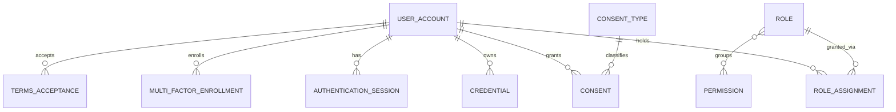

### 5.2 Participants & Institutions

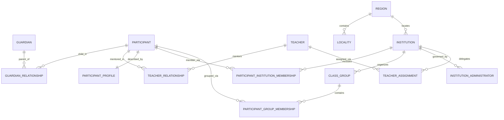

### 5.3 Competitions

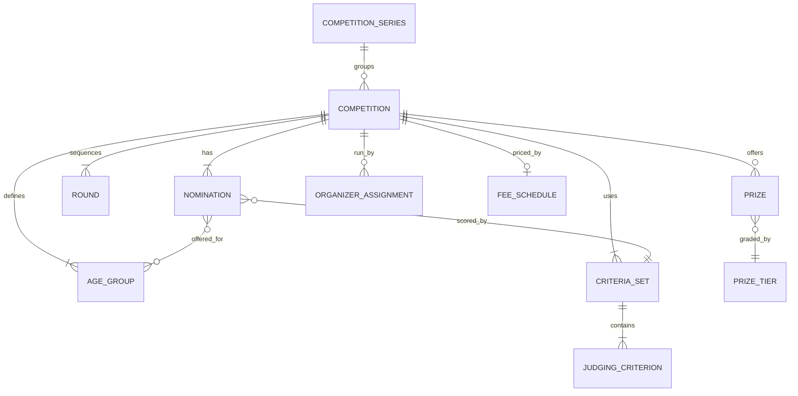

### 5.4 Applications

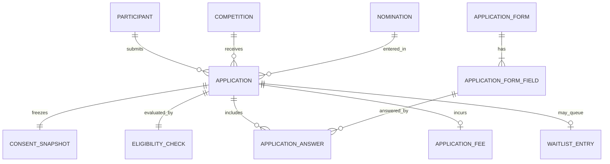

### 5.5 Performances

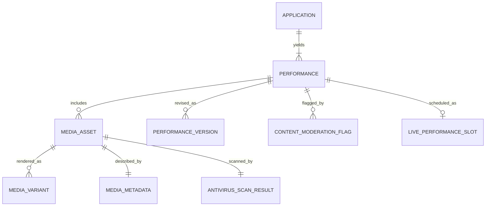

### 5.6 Judging

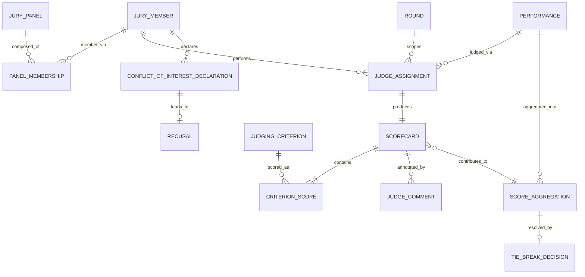

### 5.7 Results

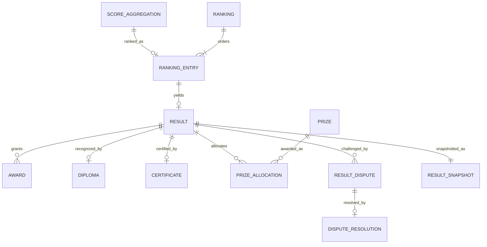

### 5.8 Finance

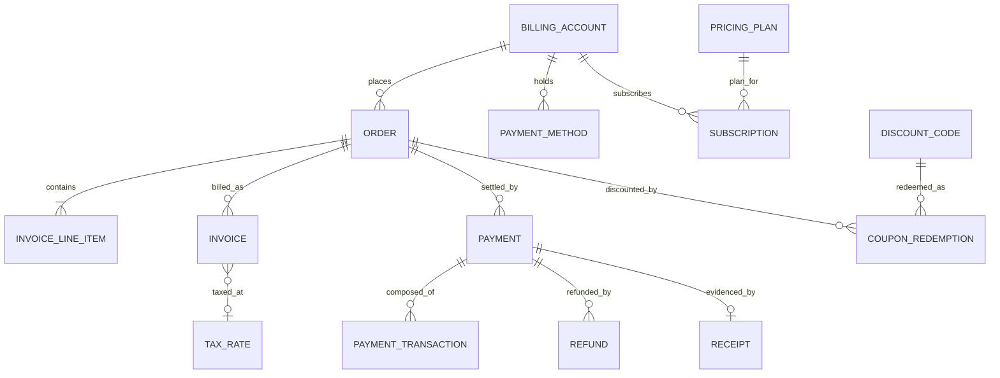

### 5.9 Notifications, Analytics & Audit

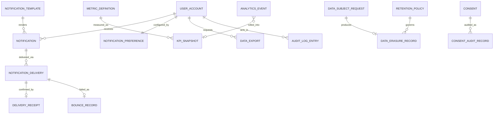

---

## 6. Relationship Matrix

Consolidated logical relationships (source → target). Legend: `1—*` one-to-many · `1—1` one-to-one · `1—0..1` one-to-zero-or-one · `*—*` many-to-many (association resolves it).

| # | From Entity | Relationship | To Entity | Cardinality | Domain(s) | Rule refs |
|---|-------------|--------------|-----------|-------------|-----------|-----------|
| 1 | USER_ACCOUNT | grants | CONSENT | 1—* | Identity | IDN-005 |
| 2 | USER_ACCOUNT | holds | ROLE_ASSIGNMENT | 1—* | Identity | IDN-008 |
| 3 | ROLE | granted via | ROLE_ASSIGNMENT | 1—* | Identity | IDN-008 |
| 4 | ROLE | groups | PERMISSION | *—* | Identity | IDN-008 |
| 5 | CONSENT_TYPE | classifies | CONSENT | 1—* | Identity | IDN-005 |
| 6 | GUARDIAN | parent of | PARTICIPANT | *—* (via GUARDIAN_RELATIONSHIP) | Participants | PRT-001 |
| 7 | TEACHER | mentors | PARTICIPANT | *—* (via TEACHER_RELATIONSHIP) | Participants | PRT-004 |
| 8 | PARTICIPANT | member of | INSTITUTION | *—* (via membership) | Participants/Institutions | INS-002 |
| 9 | PARTICIPANT | grouped in | CLASS_GROUP | *—* (via membership) | Institutions | INS-004 |
| 10 | PARTICIPANT | described by | PARTICIPANT_PROFILE | 1—1 | Participants | PRT-006 |
| 11 | PARTICIPANT | **submits** | **APPLICATION** | **1—\*** | Participants/Applications | APP-001 |
| 12 | INSTITUTION | organizes | CLASS_GROUP | 1—* | Institutions | INS-004 |
| 13 | INSTITUTION | governed by | INSTITUTION_ADMINISTRATOR | 1—* | Institutions | INS-002 |
| 14 | INSTITUTION | delegates | TEACHER_ASSIGNMENT | 1—* | Institutions | INS-003 |
| 15 | REGION | contains | LOCALITY | 1—* | Institutions | — |
| 16 | REGION | locates | INSTITUTION | 1—* | Institutions | — |
| 17 | COMPETITION_SERIES | groups | COMPETITION | 1—* | Competitions | — |
| 18 | COMPETITION | **has** | **NOMINATION** | **1—\*** | Competitions | CMP-002 |
| 19 | COMPETITION | defines | AGE_GROUP | 1—* | Competitions | CMP-002 |
| 20 | COMPETITION | sequences | ROUND | 1—* | Competitions | CMP-005 |
| 21 | COMPETITION | uses | CRITERIA_SET | 1—* | Competitions | CMP-004 |
| 22 | CRITERIA_SET | contains | JUDGING_CRITERION | 1—* | Competitions | CMP-004 |
| 23 | NOMINATION | scored by | CRITERIA_SET | *—1 | Competitions | JDG-004 |
| 24 | NOMINATION | offered for | AGE_GROUP | *—* | Competitions | CMP-002 |
| 25 | COMPETITION | offers | PRIZE | 1—* | Competitions | CMP-007 |
| 26 | PRIZE | graded by | PRIZE_TIER | *—1 | Competitions | — |
| 27 | COMPETITION | run by | ORGANIZER_ASSIGNMENT | 1—* | Competitions | CMP-008 |
| 28 | COMPETITION | priced by | FEE_SCHEDULE | 1—0..1 | Competitions | APP-003 |
| 29 | COMPETITION | **receives** | **APPLICATION** | **1—\*** | Competitions/Applications | APP-002 |
| 30 | NOMINATION | entered in | APPLICATION | 1—* | Applications | APP-002 |
| 31 | APPLICATION | freezes | CONSENT_SNAPSHOT | 1—1 | Applications | APP-006 |
| 32 | APPLICATION | evaluated by | ELIGIBILITY_CHECK | 1—1 | Applications | APP-002 |
| 33 | APPLICATION | includes | APPLICATION_ANSWER | 1—* | Applications | APP-002 |
| 34 | APPLICATION | incurs | APPLICATION_FEE | 1—0..1 | Applications | APP-003 |
| 35 | APPLICATION | may queue | WAITLIST_ENTRY | 1—0..1 | Applications | APP-007 |
| 36 | APPLICATION_FORM | has | APPLICATION_FORM_FIELD | 1—* | Applications | APP-002 |
| 37 | APPLICATION | **yields** | **PERFORMANCE** | **1—1..\*** | Applications/Performances | PRF-001 |
| 38 | PERFORMANCE | includes | MEDIA_ASSET | 1—* | Performances | PRF-003 |
| 39 | MEDIA_ASSET | rendered as | MEDIA_VARIANT | 1—* | Performances | PRF-004 |
| 40 | MEDIA_ASSET | described by | MEDIA_METADATA | 1—1 | Performances | PRF-004 |
| 41 | MEDIA_ASSET | scanned by | ANTIVIRUS_SCAN_RESULT | 1—1 | Performances | PRF-002 |
| 42 | PERFORMANCE | revised as | PERFORMANCE_VERSION | 1—* | Performances | PRF-005 |
| 43 | PERFORMANCE | flagged by | CONTENT_MODERATION_FLAG | 1—* | Performances | PRF-006 |
| 44 | JURY_PANEL | composed of | PANEL_MEMBERSHIP | 1—* | Judging | JDG-007 |
| 45 | JURY_MEMBER | member via | PANEL_MEMBERSHIP | 1—* | Judging | JDG-007 |
| 46 | JURY_MEMBER | performs | JUDGE_ASSIGNMENT | 1—* | Judging | JDG-002 |
| 47 | PERFORMANCE | **judged via** | **JUDGE_ASSIGNMENT** | **1—\*** | Performances/Judging | JDG-002 |
| 48 | ROUND | scopes | JUDGE_ASSIGNMENT | 1—* | Judging | JDG-003 |
| 49 | JUDGE_ASSIGNMENT | produces | SCORECARD | 1—1 | Judging | JDG-004 |
| 50 | PERFORMANCE | **scored by** | **SCORECARD** | **1—\*** | Judging | JDG-009 |
| 51 | SCORECARD | contains | CRITERION_SCORE | 1—* | Judging | JDG-004 |
| 52 | SCORECARD | authored by | JURY_MEMBER | *—1 | Judging | JDG-002 |
| 53 | JUDGING_CRITERION | scored as | CRITERION_SCORE | 1—* | Judging | JDG-005 |
| 54 | JURY_MEMBER | declares | CONFLICT_OF_INTEREST_DECLARATION | 1—* | Judging | JDG-007 |
| 55 | CONFLICT_OF_INTEREST_DECLARATION | leads to | RECUSAL | 1—0..1 | Judging | JDG-011 |
| 56 | PERFORMANCE | aggregated into | SCORE_AGGREGATION | 1—* | Judging | JDG-009 |
| 57 | SCORECARD | contributes to | SCORE_AGGREGATION | *—1 | Judging | JDG-009 |
| 58 | SCORE_AGGREGATION | resolved by | TIE_BREAK_DECISION | 1—0..1 | Judging | JDG-010 |
| 59 | SCORE_AGGREGATION | ranked as | RANKING_ENTRY | 1—0..1 | Judging/Results | RES-003 |
| 60 | RANKING | orders | RANKING_ENTRY | 1—* | Results | RES-003 |
| 61 | RANKING_ENTRY | yields | RESULT | 1—0..1 | Results | RES-003 |
| 62 | RESULT | grants | AWARD | 1—* | Results | RES-008 |
| 63 | RESULT | **recognized by** | **DIPLOMA** | **1—1** | Results | RES-004 |
| 64 | RESULT | certified by | CERTIFICATE | 1—0..1 | Results | RES-004 |
| 65 | RESULT | allocates | PRIZE_ALLOCATION | 1—* | Results | RES-008 |
| 66 | PRIZE | awarded as | PRIZE_ALLOCATION | 1—* | Results | CMP-007 |
| 67 | RESULT | challenged by | RESULT_DISPUTE | 1—* | Results | RES-007 |
| 68 | RESULT_DISPUTE | resolved by | DISPUTE_RESOLUTION | 1—0..1 | Results | RES-007 |
| 69 | BILLING_ACCOUNT | places | ORDER | 1—* | Finance | FIN-001 |
| 70 | ORDER | contains | INVOICE_LINE_ITEM | 1—* | Finance | FIN-003 |
| 71 | ORDER | billed as | INVOICE | 1—* | Finance | FIN-005 |
| 72 | ORDER | **settled by** | **PAYMENT** | **1—\*** | Finance | FIN-001 |
| 73 | PAYMENT | composed of | PAYMENT_TRANSACTION | 1—* | Finance | FIN-006 |
| 74 | PAYMENT | refunded by | REFUND | 1—* | Finance | FIN-004 |
| 75 | DISCOUNT_CODE | redeemed as | COUPON_REDEMPTION | 1—* | Finance | FIN-007 |
| 76 | ORDER | discounted by | COUPON_REDEMPTION | 1—* | Finance | FIN-003 |
| 77 | BILLING_ACCOUNT | subscribes | SUBSCRIPTION | 1—* | Finance | FIN-001 |
| 78 | APPLICATION | billed as | ORDER | 1—0..1 | Applications/Finance | APP-003 |
| 79 | USER_ACCOUNT | **receives** | **NOTIFICATION** | **1—\*** | Notifications | NTF-001 |
| 80 | NOTIFICATION_TEMPLATE | renders | NOTIFICATION | 1—* | Notifications | NTF-003 |
| 81 | USER_ACCOUNT | configured by | NOTIFICATION_PREFERENCE | 1—1 | Notifications | NTF-001 |
| 82 | NOTIFICATION | delivered via | NOTIFICATION_DELIVERY | 1—* | Notifications | NTF-001 |
| 83 | METRIC_DEFINITION | measured as | KPI_SNAPSHOT | 1—* | Analytics | ANL-003 |
| 84 | ANALYTICS_EVENT | rolled into | KPI_SNAPSHOT | *—0..1 | Analytics | ANL-001 |
| 85 | USER_ACCOUNT | requests | DATA_EXPORT | 1—* | Analytics | ANL-004 |
| 86 | USER_ACCOUNT | acts in | AUDIT_LOG_ENTRY | 1—* | Audit | AUD-001 |
| 87 | DATA_SUBJECT_REQUEST | produces | DATA_ERASURE_RECORD | 1—0..1 | Audit | AUD-003 |
| 88 | RETENTION_POLICY | governs | DATA_ERASURE_RECORD | 1—* | Audit | AUD-005 |
| 89 | CONSENT | audited as | CONSENT_AUDIT_RECORD | 1—* | Audit | AUD-001 |
| 90 | LEGAL_HOLD | holds | (any entity by identity) | 1—* | Audit | AUD-004 |

---

## 7. Aggregate Diagrams

Each aggregate root and the entities inside its consistency boundary (accessed only through the root). Cross-aggregate links are references by identity (see §8).

### 7.1 Competition Aggregate

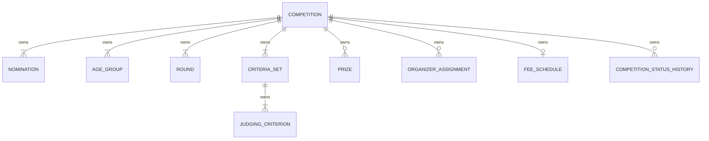

### 7.2 Application Aggregate

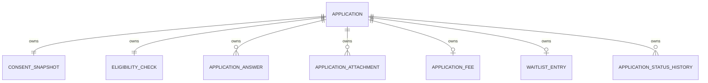

### 7.3 Performance Aggregate

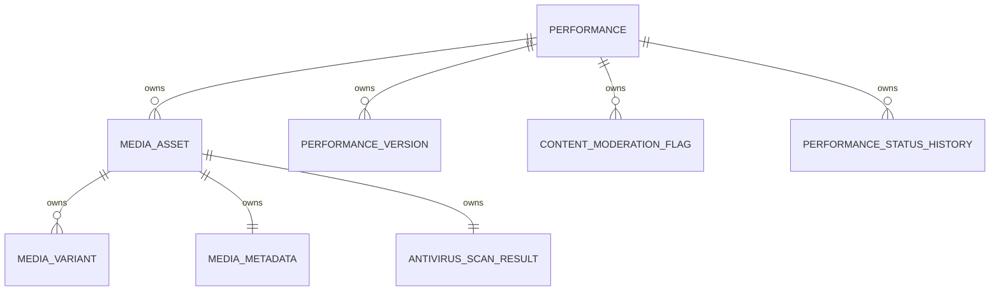

### 7.4 Scorecard Aggregate

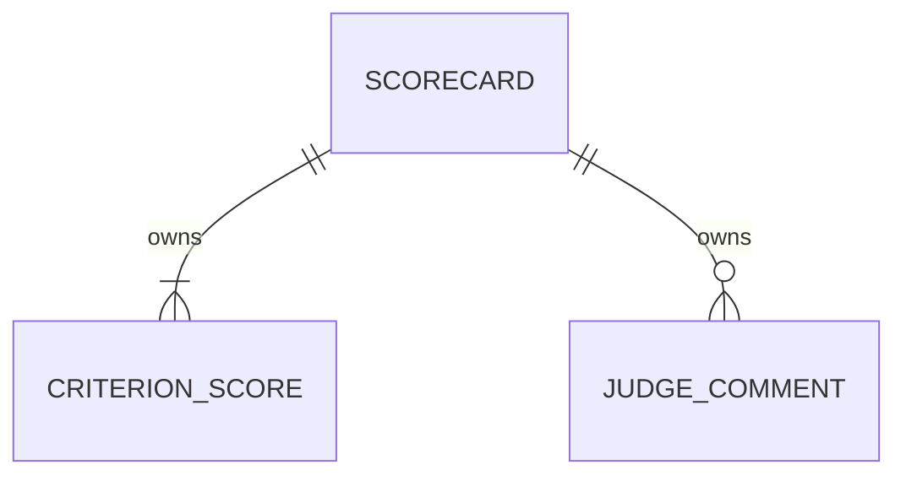

### 7.5 Result Aggregate

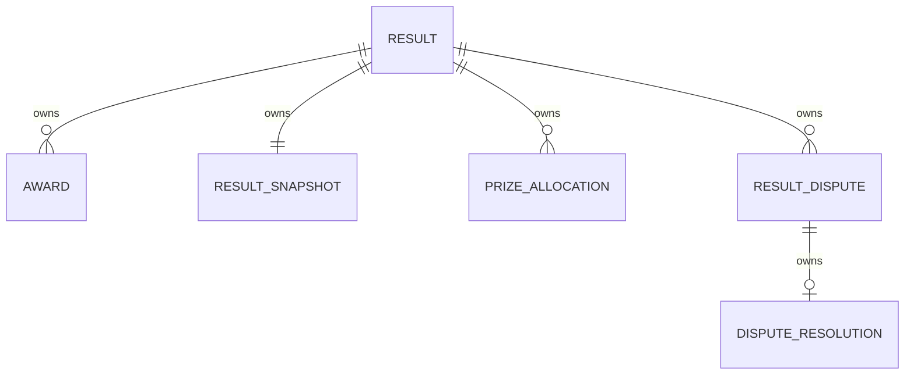

### 7.6 Order & Payment Aggregates

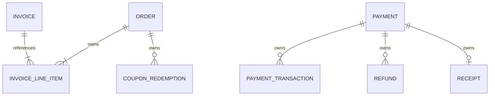

---

## 8. Cross-Domain Relationships

These relationships **cross bounded-context boundaries**. Per [ARCH-001 §9.2](../architecture/ARCH-001-vt-platform-architecture.md#9-database-architecture), they are held **by identity** (a logical reference to another aggregate's global identifier), resolved through the owning domain's interface — **never** by physical foreign keys across schemas, and never by nesting one aggregate inside another.

| From (domain) | Reference | To (domain) | Kind | Mediating event (DATA-003) |
|---------------|-----------|-------------|------|----------------------------|
| CONSENT (Identity) | about | PARTICIPANT (Participants) | ID reference | ConsentGranted |
| APPLICATION (Applications) | for | PARTICIPANT (Participants) | ID reference | ParticipantActivated |
| APPLICATION (Applications) | into | COMPETITION/NOMINATION (Competitions) | ID reference | CompetitionOpened |
| APPLICATION (Applications) | billed as | ORDER (Finance) | ID reference | OrderCreated / PaymentCaptured |
| PERFORMANCE (Performances) | belongs to | APPLICATION (Applications) | ID reference | ApplicationAccepted |
| JUDGE_ASSIGNMENT (Judging) | of | PERFORMANCE (Performances) | ID reference (pseudonymized) | PerformanceAccepted / JudgeAssigned |
| JUDGE_ASSIGNMENT (Judging) | within | ROUND (Competitions) | ID reference | JudgingStarted |
| SCORE_AGGREGATION (Judging) | feeds | RANKING_ENTRY / RESULT (Results) | ID reference | ScoreAggregated |
| RESULT (Results) | for | PARTICIPANT (Participants) | ID reference (privacy-scoped) | ResultPublished |
| DIPLOMA (Results) | for | PARTICIPANT (Participants) | ID reference | DiplomaGenerated |
| PRIZE_ALLOCATION (Results) | of | PRIZE (Competitions) | ID reference | PrizeAllocated |
| ORDER (Finance) | for | APPLICATION (Applications) | ID reference | OrderCreated |
| NOTIFICATION (Notifications) | to | USER_ACCOUNT (Identity) | ID reference | (all milestone events) |
| ROLE_ASSIGNMENT (Identity) | scoped to | INSTITUTION/COMPETITION | ID reference | RoleAssigned |
| ANALYTICS_EVENT (Analytics) | derived from | (any) domain event | pseudonymized ID reference | (all events) |
| AUDIT_LOG_ENTRY (Audit) | records | (any entity) | polymorphic ID reference | ActionRecorded |
| LEGAL_HOLD (Audit) | holds | (any entity) | polymorphic ID reference | LegalHoldPlaced |
| RETENTION_POLICY (Audit) | governs | (all domains) | policy reference | DataErased |

---

## 9. Referential Integrity Rules

Logical integrity constraints the model guarantees (enforced technically per [ARCH-001 §9](../architecture/ARCH-001-vt-platform-architecture.md#9-database-architecture), but stated here at the business/logical level).

1. **Intra-aggregate integrity is strong.** A child entity cannot exist without its aggregate root (e.g., a CRITERION_SCORE requires a SCORECARD; an INVOICE_LINE_ITEM requires an ORDER/INVOICE). These are strong (mandatory) references within one context and ACID-consistent ([ARCH-001 §7.4](../architecture/ARCH-001-vt-platform-architecture.md#7-backend-architecture)).
2. **Cross-aggregate references are by identity and eventually consistent.** A reference to another aggregate (e.g., APPLICATION → PARTICIPANT) points to a global identifier; the target must have existed when the reference was created (validated via the owning interface), but the two live in separate consistency boundaries and are reconciled by events ([ARCH-001 §7.4](../architecture/ARCH-001-vt-platform-architecture.md#7-backend-architecture)).
3. **No orphaned mandatory references.** A PERFORMANCE must reference an existing accepted APPLICATION; a SCORECARD must reference an existing JUDGE_ASSIGNMENT; a DIPLOMA must reference a published RESULT ([RES-004](../business/DATA-002-business-rules-catalog.md#rule-res-004)).
4. **Association entities require both ends.** GUARDIAN_RELATIONSHIP, TEACHER_ASSIGNMENT, PANEL_MEMBERSHIP, COUPON_REDEMPTION, etc., are invalid without both referenced entities.
5. **Snapshots are decoupled after capture.** CONSENT_SNAPSHOT and RESULT_SNAPSHOT capture referenced data at a point in time and remain valid even if the source later changes ([APP-006](../business/DATA-002-business-rules-catalog.md#rule-app-006), [RES-002](../business/DATA-002-business-rules-catalog.md#rule-res-002)).
6. **Uniqueness constraints.** One verified EMAIL ↔ one active USER_ACCOUNT ([IDN-003](../business/DATA-002-business-rules-catalog.md#rule-idn-003)); each DIPLOMA/CERTIFICATE has a unique VERIFICATION_CODE ([RES-005](../business/DATA-002-business-rules-catalog.md#rule-res-005)); each INVOICE has a unique invoice number ([FIN-005](../business/DATA-002-business-rules-catalog.md#rule-fin-005)).
7. **Quantitative integrity.** Σ PRIZE_ALLOCATION ≤ PRIZE.quantity ([CMP-007](../business/DATA-002-business-rules-catalog.md#rule-cmp-007)); Σ REFUND ≤ PAYMENT.captured ([FIN-004](../business/DATA-002-business-rules-catalog.md#rule-fin-004)); Σ CRITERION weights = defined whole ([CMP-004](../business/DATA-002-business-rules-catalog.md#rule-cmp-004)).
8. **Audit references never dangle but never block.** AUDIT_LOG_ENTRY references subjects by identity; if a subject is later erased, the audit entry persists with a minimized/pseudonymized reference ([AUD-002](../business/DATA-002-business-rules-catalog.md#rule-aud-002), [PRT-007](../business/DATA-002-business-rules-catalog.md#rule-prt-007)).

---

## 10. Deletion Strategy

For every major entity: **Cascade** (delete children with parent), **Restrict** (block delete while dependents exist), **Soft Delete** (mark inactive, retain), **Archive** (move to read-only, retain), governed by [RETENTION_POLICY](../business/DATA-002-business-rules-catalog.md#rule-aud-005), [PRT-007](../business/DATA-002-business-rules-catalog.md#rule-prt-007), [AUD-002](../business/DATA-002-business-rules-catalog.md#rule-aud-002), and [FIN-008](../business/DATA-002-business-rules-catalog.md#rule-fin-008). "Erase" means true removal after retention, per DSAR.

| Entity | Cascade | Restrict | Soft Delete | Archive | Notes |
|--------|:------:|:-------:|:----------:|:-------:|-------|
| USER_ACCOUNT | | ✔ | ✔ | ✔ | Deactivate (soft) → erase per DSAR; audit retained ([IDN-007](../business/DATA-002-business-rules-catalog.md#rule-idn-007)) |
| ROLE / PERMISSION | | ✔ | | ✔ | Restrict while assigned; deprecate not delete |
| ROLE_ASSIGNMENT | ✔ (with account) | | ✔ | | Revoke = soft delete; audited |
| CONSENT | | ✔ | ✔ | ✔ | Never hard-deleted; withdrawal is a state; history retained |
| PARTICIPANT | ✔ (to media on erase) | | ✔ | ✔ | Archive then Erase via DSAR ([PRT-007](../business/DATA-002-business-rules-catalog.md#rule-prt-007)) |
| GUARDIAN / TEACHER | | ✔ | ✔ | ✔ | Restrict while active relationships exist |
| GUARDIAN_RELATIONSHIP | ✔ (with participant) | | ✔ | | Revoke = soft delete |
| INSTITUTION | | ✔ | ✔ | ✔ | Restrict while active members; archive on exit |
| CLASS_GROUP | ✔ (memberships) | | ✔ | ✔ | Memberships cascade; group archived |
| COMPETITION | | ✔ | | ✔ | Never deleted post-publish; Cancelled/Archived states ([CMP-006](../business/DATA-002-business-rules-catalog.md#rule-cmp-006)) |
| NOMINATION / ROUND / CRITERIA_SET | ✔ (with competition, pre-publish) | ✔ (post-freeze) | | ✔ | Restrict once frozen ([CMP-005](../business/DATA-002-business-rules-catalog.md#rule-cmp-005)) |
| APPLICATION | ✔ (children) | | ✔ | ✔ | Withdraw = state; children cascade on erase |
| CONSENT_SNAPSHOT | | ✔ | | ✔ | Immutable evidence; retained ([APP-006](../business/DATA-002-business-rules-catalog.md#rule-app-006)) |
| PERFORMANCE | ✔ (media/variants) | | ✔ | ✔ | Media cascade-erased with participant |
| MEDIA_ASSET | ✔ (variants/metadata) | | ✔ | | Quarantine (soft) if infected; erase with performance |
| JUDGE_ASSIGNMENT | | ✔ | ✔ | ✔ | Void/Reassign = state; retained for audit |
| SCORECARD | | ✔ | | ✔ | Immutable once Locked ([JDG-008](../business/DATA-002-business-rules-catalog.md#rule-jdg-008)); never deleted |
| CRITERION_SCORE | ✔ (with scorecard) | ✔ (post-lock) | | ✔ | Restrict after lock |
| RESULT | | ✔ | | ✔ | Never deleted; corrected via governed path ([RES-002](../business/DATA-002-business-rules-catalog.md#rule-res-002)) |
| RANKING / RANKING_ENTRY | | ✔ | | ✔ | Superseded, not deleted |
| DIPLOMA / CERTIFICATE | | ✔ | ✔ | ✔ | Revoke (soft) on correction; verification code invalidated |
| BILLING_ACCOUNT | | ✔ | ✔ | ✔ | Restrict while open orders |
| ORDER / INVOICE | | ✔ | | ✔ | Financial records retained ([FIN-008](../business/DATA-002-business-rules-catalog.md#rule-fin-008)); void not delete |
| PAYMENT / REFUND | | ✔ | | ✔ | Never deleted; retained under lawful basis |
| NOTIFICATION | | | ✔ | ✔ | Soft-delete/expire; delivery records retained per policy |
| NOTIFICATION_TEMPLATE | | ✔ | | ✔ | Restrict while in use; deprecate |
| ANALYTICS_EVENT / KPI_SNAPSHOT | | | | ✔ | Time-expire per retention; pseudonymized |
| DATA_EXPORT | | | ✔ | | Expires per policy ([ANL-004](../business/DATA-002-business-rules-catalog.md#rule-anl-004)) |
| AUDIT_LOG_ENTRY | | ✔ | | ✔ | Append-only; purge only per retention ([AUD-002](../business/DATA-002-business-rules-catalog.md#rule-aud-002)) |
| DATA_SUBJECT_REQUEST / DATA_ERASURE_RECORD | | ✔ | | ✔ | Compliance evidence; retained |
| RETENTION_POLICY / LEGAL_HOLD | | ✔ | | ✔ | Governance records; never routinely deleted |

**Overriding principle:** an active [LEGAL_HOLD](../business/DATA-002-business-rules-catalog.md#rule-aud-004) suspends any Cascade/Soft-Delete/Erase; financial and audit records survive participant erasure under independent lawful bases ([FIN-008](../business/DATA-002-business-rules-catalog.md#rule-fin-008), [AUD-002](../business/DATA-002-business-rules-catalog.md#rule-aud-002)).

---

## 11. History Strategy

How change-over-time is preserved at the logical level (physical realization per [ARCH-001 §9.4](../architecture/ARCH-001-vt-platform-architecture.md#9-database-architecture)).

- **Status-history entities.** Lifecycle-heavy aggregates keep explicit history: COMPETITION_STATUS_HISTORY, APPLICATION_STATUS_HISTORY, PERFORMANCE_STATUS_HISTORY — an append-only trace of every state transition (mirrors [DATA-004](../business/DATA-004-state-machine-catalog.md) transitions).
- **Versioned entities.** PERFORMANCE_VERSION captures work revisions; CRITERIA_SET and NOMINATION carry versions frozen at scoring; CONSENT is versioned by consent-text version. Superseded versions are retained, never overwritten.
- **Snapshots.** CONSENT_SNAPSHOT (at application) and RESULT_SNAPSHOT (at publication) are immutable point-in-time copies used for evidence and dispute defense.
- **Standard temporal attributes.** Every entity carries `created` / `updated` business timestamps and creator identity (logical), per [ARCH-001 §9.4](../architecture/ARCH-001-vt-platform-architecture.md#9-database-architecture).
- **Immutability where declared.** Locked SCORECARD, Issued INVOICE, Published RESULT, and any Audit record are never edited; changes occur via new versions/corrections.
- **Retention-bound.** History is kept for the period defined by RETENTION_POLICY, then erased — unless under LEGAL_HOLD or an independent lawful basis.

---

## 12. Audit Strategy

- **Universal audit.** Every fairness-, money-, access-, or privacy-significant change produces an AUDIT_LOG_ENTRY ([AUD-001](../business/DATA-002-business-rules-catalog.md#rule-aud-001); event ActionRecorded [EVT-AUD-001](../business/DATA-003-domain-event-catalog.md#evt-aud-001)). This includes: consent grant/withdrawal, role/authorization changes, scoring (ScorecardSubmitted), result publication, payment/refund, and all personal-data operations.
- **Append-only & tamper-evident.** Audit entries are never updated or deleted outside RETENTION_POLICY ([AUD-002](../business/DATA-002-business-rules-catalog.md#rule-aud-002)); they are separate from operational logs ([ARCH-001 §19.3](../architecture/ARCH-001-vt-platform-architecture.md#19-logging), §21.7).
- **Polymorphic subject reference.** AUDIT_LOG_ENTRY references its subject by identity + entity type (logical polymorphic reference), so any entity can be audited without cross-schema coupling.
- **Specialized audit records.** CONSENT_AUDIT_RECORD (consent history), CHANGE_RECORD (before/after of significant data changes), ACCESS_LOG_ENTRY (data access), ADMIN_ACTION_RECORD (privileged actions) — all append-only.
- **Privacy in audit.** Audit content is minimized and must not expose minor PII beyond what compliance requires; erased subjects are pseudonymized within retained audit entries ([PRT-006](../business/DATA-002-business-rules-catalog.md#rule-prt-006), [PRT-007](../business/DATA-002-business-rules-catalog.md#rule-prt-007)).
- **Correlation.** Each audit entry carries a correlation reference tying it to the originating action/trace ([ARCH-001 §19.1](../architecture/../architecture/ARCH-001-vt-platform-architecture.md#19-logging)) for end-to-end reconstruction.

---

## 13. Naming Conventions

Logical-model naming (physical naming derives from this per [ARCH-001 §26](../architecture/ARCH-001-vt-platform-architecture.md#26-coding-standards) / §9; ubiquitous language per [DATA-001 §10](../business/DATA-001-business-data-model.md#10-naming-standards)).

- **Entities:** singular business nouns. In prose/cards, PascalCase (`Participant`, `JudgeAssignment`); in Mermaid ER diagrams, `UPPER_SNAKE_CASE` (`JUDGE_ASSIGNMENT`) — a diagram convention only, not a physical naming rule.
- **Association entities:** named for the relationship (`GuardianRelationship`, `TeacherAssignment`, `CouponRedemption`).
- **History/version/snapshot entities:** suffix `…StatusHistory`, `…Version`, `…Snapshot`.
- **Attributes (logical):** lowercase business phrases in cards (`date of birth`, `award level`); realized in `snake_case` physically. Reference roles named for the role, not the type (`submitter`, `granting guardian`).
- **Identifiers:** referred to as the entity's *identity* (global or local per §2.2); never exposes storage form.
- **Relationships (verbs in diagrams):** short lowercase verb phrases (`submits`, `has`, `judged_via`, `settled_by`), read Source→Target.
- **Domains/schemas (logical):** the twelve domain names (Identity, Participants, …), aligning with [ARCH-001 §9.2](../architecture/ARCH-001-vt-platform-architecture.md#9-database-architecture) schema-per-context.
- **Consistency with the catalog:** entity names match [DATA-001 §5](../business/DATA-001-business-data-model.md#5-business-object-catalog); no synonyms are introduced.

---

## 14. Summary Statistics

### 14.1 Entity Coverage by Domain

| Domain | Entities specified (§4) |
|--------|--------------------------|
| Identity | 6 |
| Participants | 8 |
| Institutions | 6 |
| Competitions | 10 |
| Applications | 7 |
| Performances | 6 |
| Judging | 11 |
| Results | 8 |
| Finance | 8 |
| Notifications | 4 |
| Analytics | 4 |
| Audit | 6 |
| **Total entities specified** | **84** |

> These 84 entities are the relationship-bearing core of the ~155 business objects in [DATA-001 §5](../business/DATA-001-business-data-model.md#5-business-object-catalog); remaining supporting/lookup records are represented via their owning aggregates (§1.3).

### 14.2 Model Totals

| Metric | Count |
|--------|-------|
| Entities specified | **84** |
| Relationships modeled (Relationship Matrix) | **90** |
| Aggregate roots diagrammed | 6 principal aggregates (§7) |
| Per-domain ER diagrams | 9 (§5) |
| Cross-domain reference relationships | 18 (§8) |
| Referential integrity rules | 8 (§9) |
| Deletion-strategy entries | 30+ entity classes (§10) |
| Mermaid diagrams total | **16** |

### 14.3 Key Cardinalities (requested examples, confirmed)

| Relationship | Cardinality |
|--------------|-------------|
| Participant — Application | 1 ---- * |
| Competition — Nomination (Category) | 1 ---- * |
| Competition — Performance (via Application) | 1 ---- * |
| Performance — Scorecard/Score | 1 ---- * |
| Scorecard/Score — Jury Member (Judge) | * ---- 1 |
| Result — Diploma | 1 ---- 1 |

---

*End of document — DIA-001 Entity Relationship Model v1.0 (logical). Not a physical schema, ORM, or implementation. Defers to [ARCH-001 §9](../architecture/ARCH-001-vt-platform-architecture.md#9-database-architecture) for physical realization and to [DATA-001](../business/DATA-001-business-data-model.md)–[DATA-004](../business/DATA-004-state-machine-catalog.md) for business truth.*
